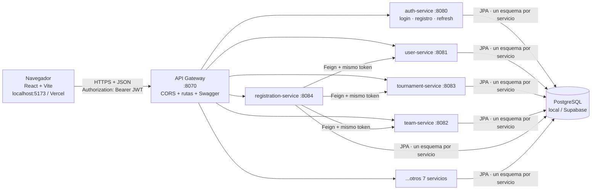

# eSports Arena Manager · Evaluación Parcial 3 (DSY1104 Desarrollo Fullstack II)

Integración del **frontend React** con el **backend de microservicios Spring Boot**, con autenticación
**JWT por roles**, **sesión persistente** en el navegador, **vistas protegidas** y preparación para el
**despliegue en la nube** (Supabase + Render.com + Vercel), siguiendo las pautas de las sesiones 1, 2 y 3.

```text
fullstack3/
├── backend/    12 microservicios + API Gateway + Eureka (Spring Boot 3.2, Java 21, PostgreSQL)
├── frontend/   React 19 + Vite + react-router + Bootstrap, pruebas Jasmine/Karma
└── docs/       Documento de integración, manual de usuario (con capturas), despliegue y guía de presentación
```

## Arquitectura



- **Un solo origen público**: el frontend solo conoce `VITE_API_URL` (el Gateway). El Gateway resuelve CORS.
- **auth-service firma** el JWT (HS512, 15 min) y entrega un **refresh token** (7 días, rotativo y revocable).
- **Cada microservicio verifica** el JWT con el mismo `JWT_SECRETO` y aplica sus reglas por rol (401/403).
- **Base de datos por servicio**: una base PostgreSQL con un esquema por microservicio (`auth`, `usuarios`, `torneos`, …).

## Ejecutar en local (resumen)

| Paso | Comando | Resultado |
| :-- | :-- | :-- |
| 1. Base de datos | `cd backend` · `docker compose up -d postgres` | PostgreSQL en `localhost:5432` |
| 2. Backend | `powershell -ExecutionPolicy Bypass -File .\scripts\levantar-backend.ps1` <br/>o todo en Docker: `docker compose up --build` | Gateway en `http://localhost:8070` |
| 3. Frontend | `cd frontend` · `npm install` · `npm run dev` | `http://localhost:5173` |

Swagger unificado: **http://localhost:8070/swagger-ui.html** (elige el servicio arriba a la derecha y usa *Authorize* con el token).

### Cuentas de prueba (datos iniciales)

| Rol | Email | Contraseña |
| :-- | :-- | :-- |
| Administrador | `admin@arena.cl` | `admin123` |
| Organizador | `organizador@arena.cl` | `organiza123` |
| Jugador (capitana de *Escuadrón Nocturno*) | `fernanda.soto@arena.cl` | `jugador123` |
| Jugador con sanción vigente | `benjamin.munoz@arena.cl` | `jugador123` |

## Pruebas

| Dónde | Comando | Qué cubre |
| :-- | :-- | :-- |
| Backend | `cd backend` · `.\mvnw.cmd test` | 139 pruebas: servicios (Mockito), JWT (firma, vencimiento, alteración), refresh token, seguridad 401/403 + CRUD con MockMvc |
| Frontend | `cd frontend` · `npm test` · `npm run test:coverage` | 150 pruebas: lógica, componentes, `solicitar()` con token y renovación, sesión en localStorage, adaptadores, permisos y `RutaProtegida` |
| Integración | Postman: `backend/postman/esports-arena-parcial3.postman_collection.json` | 30 peticiones / 34 verificaciones a través del Gateway (login, 401/403, CRUD, reglas de dueño, logout) |

## Documentación

- [Documento de integración](docs/DOCUMENTO_INTEGRACION.md) — cómo se cumple cada indicador de la pauta.
- [Manual de usuario](docs/MANUAL_USUARIO.md) — paso a paso con capturas por rol.
- [Despliegue en la nube](docs/DESPLIEGUE.md) — Supabase, Render.com y Vercel.
- [Guía para la presentación](docs/GUIA_PRESENTACION.md) — qué mostrar y dónde está cada cosa en el código.

## Entregables de la pauta

- [x] Repositorio GitHub público del **frontend** (subir la carpeta `frontend`).
- [x] Repositorio GitHub público del **backend** (subir la carpeta `backend`).
- [x] Proyectos comprimidos (sin `node_modules/` ni `target/`).
- [x] Manual de usuario con pantallazos → `docs/MANUAL_USUARIO.md` + `docs/capturas/`.
- [x] Documento de integración → `docs/DOCUMENTO_INTEGRACION.md`.
