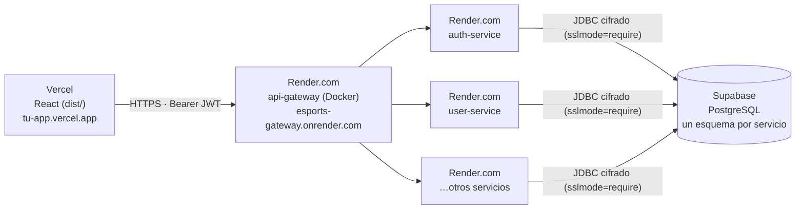

# Despliegue en la nube (sesión 3): Supabase + Render.com + Vercel

El código no cambia entre local y producción: solo cambian **variables de entorno**.



| Dato | En tu computador | En internet | Dónde se define |
| :-- | :-- | :-- | :-- |
| URL de la API | `http://localhost:8070/api/v1` | `https://esports-gateway.onrender.com/api/v1` | `VITE_API_URL` en Vercel |
| Base de datos | `localhost:5432` | Supabase (pooler) | `DB_URL`, `DB_USUARIO`, `DB_CLAVE` en cada servicio |
| Orígenes CORS | `http://localhost:5173` | `https://tu-app.vercel.app` | `CORS_ORIGENES` en el Gateway |
| Secreto del JWT | clave de desarrollo | clave larga al azar | `JWT_SECRETO` (**igual en todos los servicios**) |
| Puerto | 8070, 8080… | el que asigne Render | `PORT` (Render lo define solo) |

## 1. Supabase (base de datos)

1. *New project* → región **East US (North Virginia)** (la misma de Render). Guarda la contraseña: será `DB_CLAVE`.
2. Botón **Connect** → copia los datos del **Transaction pooler** (puerto `6543`). Con 12 microservicios conviene el
   pooler de transacciones porque admite muchas más conexiones que el *Session pooler*.
3. Arma las variables:

```text
DB_URL=jdbc:postgresql://aws-1-us-east-1.pooler.supabase.com:6543/postgres?sslmode=require&prepareThreshold=0
DB_USUARIO=postgres.<id-de-tu-proyecto>
DB_CLAVE=<la contraseña de la base>
```

> `prepareThreshold=0` es necesario con el pooler de transacciones. Si usas el *Session pooler* (puerto 5432),
> quítalo y deja `DB_POOL_MAX=1` para no superar el límite de conexiones del plan gratuito.

Cada microservicio crea su propio esquema (`auth`, `usuarios`, `torneos`…) al arrancar (`create_namespaces`).
En *Table Editor* aparecerán las tablas y los datos iniciales.

## 2. Render.com (backend en Docker)

Sube la carpeta `backend/` a GitHub. Por cada servicio crea un **Web Service** → *Docker*:

| Campo | Valor |
| :-- | :-- |
| Root Directory | `auth-service` (o el servicio que corresponda) |
| Dockerfile Path | `./Dockerfile` |
| Instance Type | Free |
| Health Check Path | `/actuator/health` |

Variables comunes a **todos** los microservicios:

```text
SPRING_PROFILES_ACTIVE=prod
DB_URL=…            DB_USUARIO=…            DB_CLAVE=…
JWT_SECRETO=<el mismo en todos: openssl rand -base64 48>
EUREKA_ENABLED=false
DB_POOL_MAX=2
```

Variables de URL (cada servicio solo necesita las de los servicios que llama con Feign):

| Servicio | Variables de URL |
| :-- | :-- |
| auth-service | `USER_SERVICE_URL` |
| team-service | `USER_SERVICE_URL`, `GAME_SERVICE_URL` |
| tournament-service | `GAME_SERVICE_URL` |
| registration-service | `TOURNAMENT_SERVICE_URL`, `TEAM_SERVICE_URL`, `USER_SERVICE_URL`, `SANCTION_SERVICE_URL` |
| sanction-service | `USER_SERVICE_URL`, `TEAM_SERVICE_URL` |
| match-service | `TOURNAMENT_SERVICE_URL`, `REGISTRATION_SERVICE_URL` |
| result-service | `MATCH_SERVICE_URL` |
| prize-service | `TOURNAMENT_SERVICE_URL`, `RANKING_SERVICE_URL` |
| **api-gateway** | **las 12** `*_SERVICE_URL` + `CORS_ORIGENES=https://tu-app.vercel.app` |

Ejemplo: `USER_SERVICE_URL=https://esports-user-service.onrender.com` (sin `/` al final).

Orden recomendado: `user-service`, `game-service`, `auth-service`, el resto y al final `api-gateway`.
El Gateway no necesita base de datos ni `JWT_SECRETO`.

> **Plan gratuito:** cada servicio se duerme tras 15 minutos sin uso y tarda ~1 minuto en despertar, y las
> horas gratuitas del mes se comparten entre todos. Para la presentación, abre la app unos minutos antes.
> Alternativa: desplegar solo los servicios que usa el frontend (todos menos `ranking-service` y `discovery-server`).

Prueba rápida:

```bash
API=https://esports-gateway.onrender.com/api/v1
curl $API/torneos
curl -X POST $API/auth/login -H "Content-Type: application/json" -d '{"email":"admin@arena.cl","password":"admin123"}'
```

## 3. Vercel (frontend)

1. Sube la carpeta `frontend/` a GitHub e impórtala en Vercel (framework **Vite**, comando `npm run build`, salida `dist`).
2. *Settings → Environment Variables*: `VITE_API_URL=https://esports-gateway.onrender.com/api/v1`.
3. `vercel.json` (ya incluido) responde `index.html` en cualquier ruta: recargar `/admin` no da 404.
4. Copia la URL final (`https://tu-app.vercel.app`) en `CORS_ORIGENES` del Gateway y vuelve a desplegarlo.

## Errores frecuentes

| Lo que ves | Causa | Solución |
| :-- | :-- | :-- |
| Error de CORS en la consola | `CORS_ORIGENES` no tiene la URL exacta (https, sin `/` final) | Corregir en el Gateway y *Save, rebuild and deploy* |
| `Could not resolve placeholder 'DB_URL'` | Falta la variable con el perfil `prod` | Agregarla en Render |
| `JWT_SECRETO es muy corto` | Menos de 32 bytes | Usar `openssl rand -base64 48` |
| 401 en todo después de desplegar | El token se firmó con otro secreto | Mismo `JWT_SECRETO` en todos; iniciar sesión otra vez |
| `prepared statement "S_1" already exists` | Pooler de transacciones sin `prepareThreshold=0` | Agregarlo a `DB_URL` |
| `Max client connections reached` | Demasiadas conexiones a Supabase | `DB_POOL_MAX=1` o usar el pooler de transacciones |
| 404 al recargar `/perfil` en Vercel | Falta `vercel.json` | Ya viene incluido: revisar que esté junto a `package.json` |
| La app muestra "Algunos servicios no respondieron" | Un servicio de Render está despertando | Esperar 1 minuto y presionar *Reintentar* |
