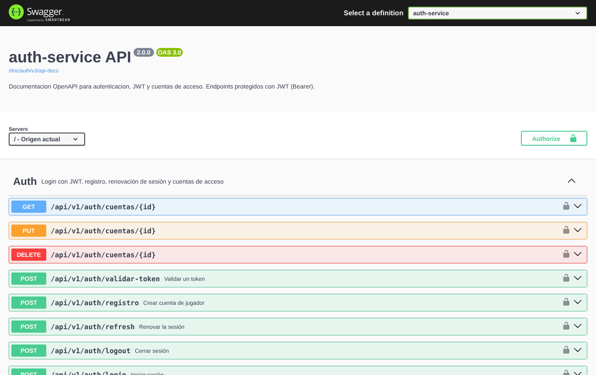
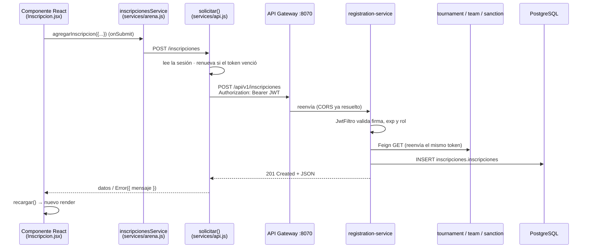
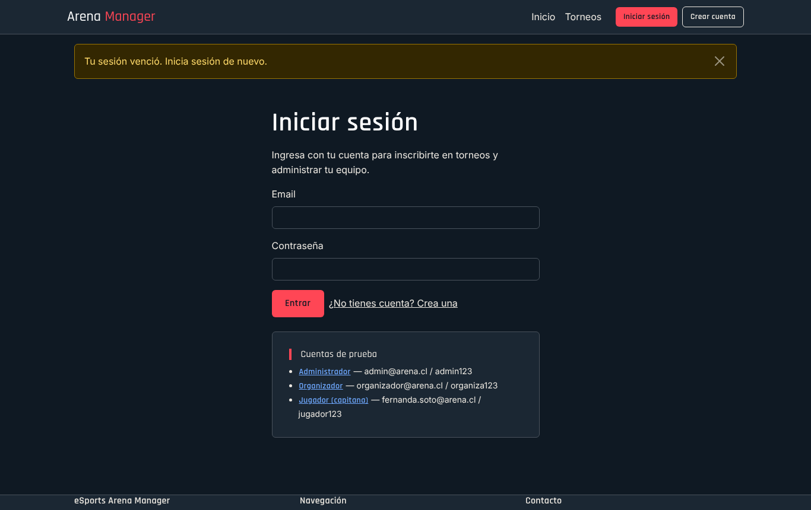
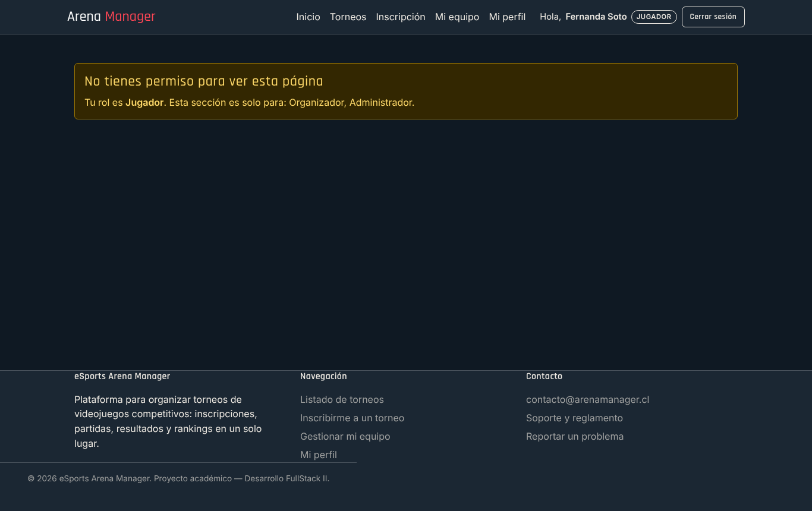

# Documento de integración · eSports Arena Manager

**Asignatura:** DSY1104 Desarrollo Fullstack II · **Evaluación Parcial 3** · Integrando backend y frontend
**Integrantes:** _(completar con los integrantes del equipo)_

Este documento explica cómo se integró el frontend React (EP2) con el backend de microservicios Spring Boot
(Fullstack I) y cómo se cumple cada punto de la pauta. Cada sección indica **dónde está el código** para mostrarlo.

---

## 1. Backend conectado a base de datos, lógica de negocio y modelos (IE3.1.1 · IE3.1.2)

### 1.1 Arquitectura y base de datos

- 12 microservicios Spring Boot 3.2 (Java 21) + **API Gateway** (Spring Cloud Gateway) + **Eureka**.
- Persistencia con **Spring Data JPA / Hibernate** sobre **PostgreSQL** (sesión 3): local con Docker y en la nube con Supabase.
- **Base de datos por servicio** implementada como **un esquema por microservicio** dentro de una misma base
  (`auth`, `usuarios`, `equipos`, `torneos`, `inscripciones`, `sanciones`, `partidas`, `juegos`, `resultados`, `rankings`, `premios`, `notificaciones`).
  Ningún servicio lee las tablas de otro: si necesita un dato, lo pide por HTTP con **OpenFeign**.
- La conexión se configura solo con variables de entorno (`DB_URL`, `DB_USUARIO`, `DB_CLAVE`) en `application.yml`;
  el perfil `prod` (`application-prod.yml`) las exige sin valores de reserva.

```yaml
# backend/tournament-service/src/main/resources/application.yml
spring:
  datasource:
    url: ${DB_URL:jdbc:postgresql://localhost:5432/esports_arena}
  jpa:
    hibernate.ddl-auto: update
    properties.hibernate.default_schema: ${DB_ESQUEMA:torneos}
```

### 1.2 Modelo de datos (requerimientos del cliente)

| Microservicio | Entidades | Requerimiento que resuelve |
| :-- | :-- | :-- |
| auth-service | `CuentaAcceso` (email, hash BCrypt, rol, estado, usuarioId, historial), `RefreshToken` | Acceso seguro con roles y sesiones revocables |
| user-service | `Usuario` (nombre, nickname único, email, rol, estado) | Perfil competitivo de jugadores, organizadores y administradores |
| game-service | `Juego` (género, modalidad EQUIPOS/INDIVIDUAL, integrantes por equipo, reglas) | Catálogo de juegos habilitados |
| tournament-service | `Torneo` (juego, fechas de cierre/inicio/fin, cupo, modalidad, estado, descripción) | Calendario y ciclo de vida del torneo |
| team-service | `Equipo` + `MiembroEquipo` (1:N, cascada) | Equipos con capitán e integrantes |
| registration-service | `Inscripcion` (torneo, jugador o equipo, tipo, estado, fecha) | Inscripciones con cupos y plazos |
| sanction-service | `Sancion` (usuario/equipo, motivo, vigencia, severidad) | Bloqueo de participantes sancionados |
| match-service / result-service | `Partida`, `Resultado` | Llaves por ronda y marcadores validados |
| ranking-service / prize-service | `Ranking`, `Premio`, `PremioAsignado` | Tabla de posiciones y premios por posición |
| notification-service | `Notificacion` | Avisos internos por usuario |

Diagramas originales: `backend/Modelo Relacional de Base de Datos.png` y `backend/Diagrama del Ecosistema de Microservicios.png`.

### 1.3 Lógica de negocio (capa `service`)

Ejemplos de reglas implementadas en los servicios (no en el controlador):

- **Inscripción** (`InscripcionService.crear`): torneo `ABIERTO` y dentro de plazo; no superar el cupo; no duplicar;
  la modalidad debe coincidir (torneo por equipos ⇒ equipos); el equipo debe jugar el juego del torneo;
  jugador activo (consulta `user-service`) y sin sanción bloqueante (consulta `sanction-service`).
  Los campos opcionales del cliente (`torneoAbierto`, `cupoMaximo`) **solo pueden endurecer** la regla, nunca saltársela.
- **Dueño del recurso**: un jugador solo se inscribe a sí mismo; solo el **capitán** inscribe o modifica su equipo
  (`UsuarioActual.esUsuario(...)`, datos tomados del JWT).
- **Torneos** (`TorneoService`): el inicio debe ser posterior al cierre de inscripción; un torneo `EN_CURSO` solo admite cambios de estado.
- **Resultados y premios**: un resultado `VALIDADO` o un premio `ASIGNADO` solo lo modifica un rol autorizado (el rol sale del token).
- **Cuentas**: contraseñas con BCrypt; cambiar el rol de una cuenta lo sincroniza con el perfil de `user-service`.
- **Errores**: `@RestControllerAdvice` (`ApiExceptionHandler`) responde siempre `{ status, error, mensaje }`; 400 de validación con los mensajes de `@Valid`.
- **Datos iniciales** (`config/DatosIniciales.java` en cada servicio): datos coherentes entre servicios para la demo.

---

## 2. API REST CRUD documentada en Swagger (IE3.2.1 · IE3.2.3)

Cada recurso expone lectura, creación, actualización y eliminación. Ejemplo `tournament-service`:

| Método | Ruta | Respuesta | Acceso |
| :-- | :-- | :-- | :-- |
| GET | `/api/v1/torneos?juegoId=&estado=&fecha=` | 200 lista | público |
| GET | `/api/v1/torneos/{id}` | 200 · 404 | público |
| POST | `/api/v1/torneos` | 201 · 400 · 401 · 403 | ORGANIZADOR / ADMINISTRADOR |
| PUT | `/api/v1/torneos/{id}` | 200 · 400 · 404 | ORGANIZADOR / ADMINISTRADOR |
| PATCH | `/api/v1/torneos/{id}/estado?nuevoEstado=` | 200 | ORGANIZADOR / ADMINISTRADOR |
| DELETE | `/api/v1/torneos/{id}` | **204** · 404 | ADMINISTRADOR |

El mismo patrón (`DELETE /{id}` → 204 agregado en esta entrega) existe para juegos, usuarios, equipos, inscripciones,
sanciones, partidas, resultados, rankings, premios, notificaciones y cuentas.

**Swagger / OpenAPI (springdoc 2.5):**

- Por servicio: `http://localhost:<puerto>/doc/swagger-ui/index.html`.
- **Unificado en el Gateway:** `http://localhost:8070/swagger-ui.html` (selector *Select a definition* con los 12 servicios).
- `config/SwaggerConfig.java` declara el esquema **bearerAuth (JWT)**: con el botón **Authorize** se pega el token del
  login y *Try it out* prueba los endpoints protegidos. El servidor `/` hace que las pruebas pasen por el Gateway.



---

## 3. Integración backend ↔ frontend por API REST (IE3.2.2 · IE3.2.4)

### 3.1 Flujo de datos



### 3.2 Decisiones para una comunicación eficiente

1. **Un solo origen**: el frontend conoce solo `VITE_API_URL` (Gateway). Cambiar de local a la nube es cambiar una variable.
2. **Capa de servicios** (sesión 1): ningún componente usa `fetch`. `solicitar()` centraliza URL, token, JSON, 204 y errores.
3. **Carga en paralelo y tolerante a fallas**: `AppContext` pide los 9 recursos con `Promise.allSettled`; si un microservicio
   cae, el resto de la app funciona y se muestra qué servicio falló con un botón *Reintentar*.
4. **Estados de carga, error y datos** en cada vista (`EstadoCarga`), y **`AbortController`** en los efectos para
   cancelar peticiones al desmontar (StrictMode).
5. **Adaptadores puros** (`services/adaptadores.js`) convierten el JSON de cada servicio al modelo que ya usaban las vistas:
   la lógica del EP2 y sus pruebas siguieron intactas.
6. **Validación en dos capas**: el frontend valida para responder al instante; el backend vuelve a validar y su
   `{ mensaje }` se muestra tal cual (por ejemplo, “No superar cupos”).
7. **CORS solo en el Gateway** (`globalcors` con `CORS_ORIGENES`), sin duplicar cabeceras en los servicios.

| Vista | Servicios que consume |
| :-- | :-- |
| Inicio / Torneos / Detalle | game, tournament, registration, match, result, prize, team, user |
| Inscripción | registration (POST, PATCH cancelar) |
| Mi equipo | team (POST, POST/DELETE miembros) |
| Mi perfil | user (PUT nickname), notification (GET protegido), sanction |
| Panel de gestión | tournament, match, result, sanction, game, auth (cuentas) |

---

## 4. Autenticación con roles y JWT en el backend (IE3.3.1 · IE3.3.4)

### 4.1 Generación

`auth-service` → `POST /api/v1/auth/login`: busca la cuenta, compara la contraseña con **BCrypt** y emite:

- **Access token JWT** (`security/JwtService.java`, librería jjwt): firmado con HMAC-SHA (clave `JWT_SECRETO` ≥ 32 bytes),
  vence en **15 minutos** (`JWT_DURACION_MS`). Payload: `sub` (email), `cuentaId`, `usuarioId`, `nombre`, `rol`, `iat`, `exp`.
- **Refresh token**: 48 bytes aleatorios (`SecureRandom`), guardado en `auth.refresh_tokens`, vence en 7 días.

```json
{ "token": "eyJhbGciOiJIUzUxMiJ9…", "refreshToken": "q3V1n8…", "tipo": "Bearer",
  "expiraEn": 1794625676000, "refreshExpiraEn": 1795229576000,
  "usuario": { "id": 5, "cuentaId": 5, "nombre": "Fernanda Soto", "email": "fernanda.soto@arena.cl", "rol": "JUGADOR" } }
```

### 4.2 Verificación (en cada microservicio)

- `security/JwtFiltro.java` (`OncePerRequestFilter`): ¿hay `Authorization`? ¿empieza con `Bearer `? ¿firma correcta y sin vencer?
  Si todo está bien, autentica al usuario con `ROLE_<rol>`; si no, la petición sigue sin usuario y las reglas deciden.
- `security/SeguridadConfig.java`: `STATELESS`, CSRF desactivado (API sin cookies), reglas por método y ruta, y
  respuestas **401** (“Sesión no válida o vencida”) y **403** (“Sin permiso para esta acción”) en JSON.

```java
// backend/tournament-service/.../security/SeguridadConfig.java
.requestMatchers(HttpMethod.GET, "/api/v1/torneos/**").permitAll()
.requestMatchers(HttpMethod.DELETE, "/api/v1/torneos/{id}").hasRole("ADMINISTRADOR")
.requestMatchers("/api/v1/torneos/**").hasAnyRole("ORGANIZADOR", "ADMINISTRADOR")
```

- Reglas de **dueño** dentro de la lógica (`UsuarioActual`): capitán del equipo, el propio jugador, etc.
- Entre microservicios, `FeignAuthConfig` reenvía el mismo token: cada servicio vuelve a validar.

### 4.3 Renovación y revocación

- `POST /auth/refresh` (`SesionService.renovar`): valida que el refresh exista, no esté revocado ni vencido y que la
  cuenta siga activa; lo **revoca** y entrega un par nuevo (**rotación**: un refresh robado sirve una sola vez).
- `POST /auth/logout`: revoca el refresh. Desactivar una cuenta revoca **todas** sus sesiones.

### 4.4 Matriz de roles

| Acción | Visitante | Jugador | Organizador | Administrador |
| :-- | :--: | :--: | :--: | :--: |
| Ver torneos, juegos, partidas, rankings | ✔ | ✔ | ✔ | ✔ |
| Inscribirse / inscribir su equipo (capitán) | — | ✔ | ✔ (a cualquiera) | ✔ (a cualquiera) |
| Crear equipo y gestionar integrantes | — | ✔ (capitán) | ✔ | ✔ |
| Crear/editar torneos, partidas, resultados, sanciones | — | — | ✔ | ✔ |
| Eliminar torneos · CRUD de juegos · cuentas y roles | — | — | — | ✔ |

### 4.5 Evidencia

- `JwtServiceTest`: claims, payload alterado (firma no coincide), token vencido, otro secreto, secreto corto.
- `SesionServiceTest`: rotación, refresh revocado/vencido, cuenta desactivada, logout.
- `SeguridadIntegracionTest` (MockMvc + H2): 401 sin token, con token alterado y vencido; 403 como jugador; CRUD como administrador.
- Postman `backend/postman/esports-arena-parcial3.postman_collection.json`: 30 peticiones / 34 verificaciones en verde.

---

## 5. Gestión de sesiones en el frontend (IE3.3.2 · IE3.3.5)

| Pieza | Archivo | Responsabilidad |
| :-- | :-- | :-- |
| Contexto | `auth/useAuth.js` | `AuthContext` + hook `useAuth()` (error claro si se usa fuera del proveedor) |
| Proveedor | `auth/AuthProvider.jsx` | Estado de la sesión; `login`, `registrar`, `logout`; escucha eventos |
| Almacenamiento | `services/sesion.js` | Única puerta a `localStorage` (clave `sesion`) |
| Peticiones | `services/api.js` | Agrega el Bearer, renueva el token, cierra la sesión ante 401 |

**Persistencia:** `useState(leerSesion)` lee `localStorage` una sola vez (función inicializadora) → la sesión
**sobrevive a F5** y a cerrar el navegador. Se guarda `{ token, refreshToken, expiraEn, refreshExpiraEn, usuario }`.

**Seguridad de la sesión:**

1. **Vida corta del access token** (15 min) + **renovación automática**: si el token vence (o vence en < 10 s),
   `solicitar()` pide `/auth/refresh` antes de la petición; si llega un 401 renueva una vez y repite.
   Varias peticiones simultáneas comparten **una sola renovación**.
2. Si la renovación falla: `borrarSesion()` + evento `sesion-expirada` → `AuthProvider` limpia el estado,
   `RutaProtegida` lleva a `/login` y se muestra “Tu sesión venció. Inicia sesión de nuevo.”
3. Al recargar, la sesión se **confirma con `GET /auth/me`** (si el administrador desactivó la cuenta, se cierra).
4. **Cerrar sesión** borra la sesión local y **revoca el refresh token** en el backend; el evento `storage`
   cierra la sesión en las demás pestañas.
5. No se guarda la contraseña ni datos sensibles; el token no se muestra en la interfaz; no se usa
   `dangerouslySetInnerHTML` (XSS). La sesión descartada por vencimiento del refresh no se reutiliza.



Pruebas: `services/sesion.spec.js` (9) y `services/api.spec.js` (10).

---

## 6. Restricciones de acceso en el frontend (IE3.3.3 · IE3.3.6)

Dos candados: la **interfaz** (React) oculta lo que el usuario no puede usar, y el **backend** es la protección real.

1. **Rutas protegidas** — `auth/RutaProtegida.jsx`:
   - Sin sesión → `<Navigate to="/login" replace state={{ desde }} />`; tras el login vuelve a la página pedida.
   - Con sesión sin el rol → “No tienes permiso para ver esta página” (sin redirigir).
   - `App.jsx`: `/inscripcion`, `/equipo`, `/perfil` exigen sesión; `/admin` exige ORGANIZADOR o ADMINISTRADOR.
2. **Permisos por acción** — `auth/permisos.js` (`PERMISOS`, `puede()`, `puedeAdministrarEquipo()`), usados con `useAuth().puede('...')`.
3. **Menú por rol** — `rutas.js` (`enlacesVisibles`): visitante ve Inicio y Torneos; jugador agrega Inscripción, Mi equipo y Mi perfil; staff ve el Panel.
4. **Ejemplos de interfaces restringidas:**
   - *Panel de gestión*: un organizador ve Torneos, Partidas y Sanciones; **Juegos** y **Usuarios y roles** solo el administrador; el botón **Eliminar** torneo solo el administrador.
   - *Inscripción*: un jugador no puede elegir a otro jugador (selector bloqueado) y solo ve los equipos que capitanea.
   - *Mi equipo*: “Agregar/Quitar integrante” solo para el capitán (o staff).
   - *Mi perfil*: el jugador ve y edita solo su perfil; el staff puede consultar cualquiera.
   - *Detalle de torneo*: sin sesión, el botón dice “Inicia sesión para inscribirte”.
5. Si alguien salta la interfaz (DevTools, Postman), el backend responde 401/403 y `solicitar()` muestra el mensaje.



Pruebas: `auth/RutaProtegida.spec.js` (4), `auth/permisos.spec.js` (6), `EncabezadoSesion.spec.js`.

---

## 7. Pruebas realizadas

| Tipo | Herramienta | Resultado |
| :-- | :-- | :-- |
| Unitarias + integración backend | JUnit 5, Mockito, MockMvc, H2 (`./mvnw test`) | **139 / 139** |
| Unitarias + componentes frontend | Jasmine + Karma (`npm test`) | **150 / 150** (cobertura ~67 % de líneas) |
| Integración API vía Gateway | Postman / Newman | **30 peticiones, 34 verificaciones** |
| Extremo a extremo | Navegador real (Chrome) | 24 verificaciones: login, recarga, roles, inscripción, equipo, CRUD, registro, sesión vencida |

## 8. Despliegue

Supabase (PostgreSQL) + Render.com (Docker, un Web Service por microservicio) + Vercel (frontend).
Paso a paso, variables y errores frecuentes en [`DESPLIEGUE.md`](DESPLIEGUE.md).
