# Manual de usuario · eSports Arena Manager

eSports Arena Manager es una plataforma web para organizar torneos de videojuegos: torneos, equipos,
inscripciones, partidas, resultados y sanciones. Lo que cada persona puede hacer depende de su **rol**.

| Rol | Qué puede hacer |
| :-- | :-- |
| **Visitante** (sin sesión) | Ver el inicio, el listado de torneos y el detalle de cada torneo |
| **Jugador** | Todo lo anterior + inscribirse, crear su equipo (como capitán), administrar sus integrantes y editar su perfil |
| **Organizador** | Todo lo del jugador + panel de gestión: torneos, partidas y resultados, sanciones |
| **Administrador** | Todo lo del organizador + juegos, cuentas y roles, y eliminar torneos |

Cuentas de prueba: `admin@arena.cl / admin123`, `organizador@arena.cl / organiza123`, `fernanda.soto@arena.cl / jugador123`.

---

## 1. Inicio

Al abrir la aplicación se muestra la portada con el estado de la arena (juegos habilitados, torneos abiertos y en curso),
los torneos destacados y los próximos cierres de inscripción. Arriba a la derecha están **Iniciar sesión** y **Crear cuenta**.

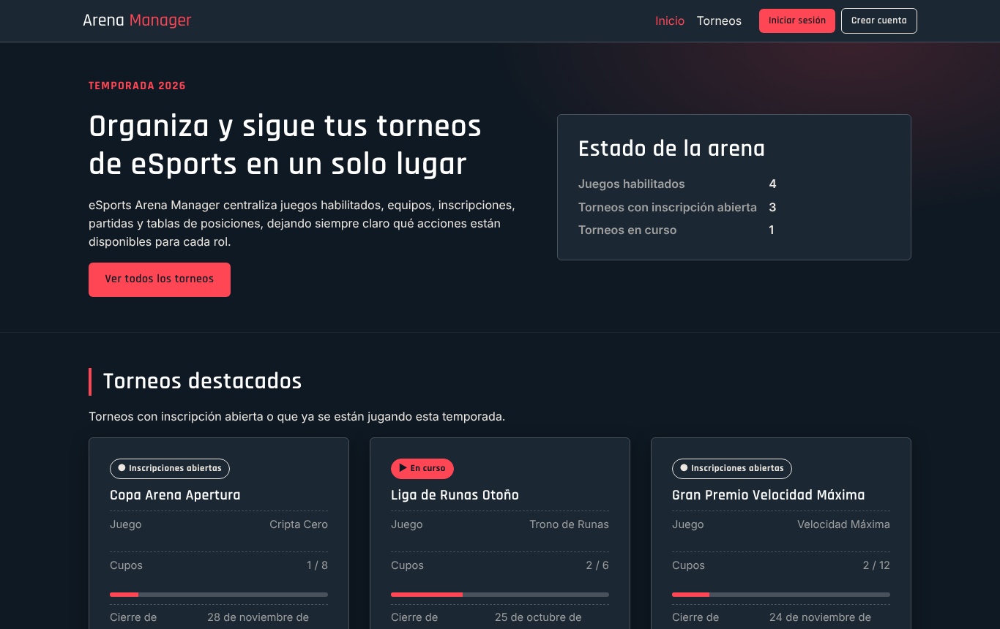

## 2. Listado y detalle de torneos

**Torneos** muestra todas las competencias. Se puede buscar por nombre y filtrar por juego, estado y rango de fechas de cierre.
Cada tarjeta indica juego, modalidad, cupos ocupados y fecha de cierre. **Ver detalle** abre la ficha del torneo.

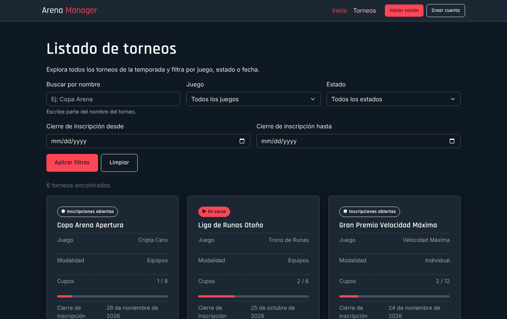

El detalle muestra la información general, los participantes inscritos, las llaves por ronda (con marcador cuando
la partida ya se jugó), la tabla de posiciones y los premios (cuando el torneo finaliza). Si el torneo está abierto,
aparece **Inscribirme a este torneo** (sin sesión dice *Inicia sesión para inscribirte*).

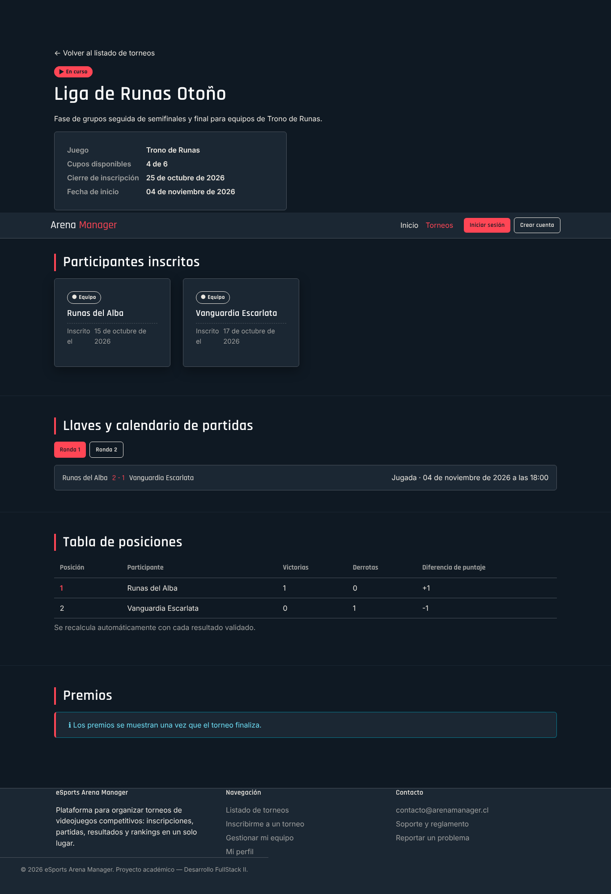

## 3. Crear cuenta e iniciar sesión

**Crear cuenta** pide nombre, apodo (3 a 16 caracteres, sin espacios), email y contraseña (mínimo 6 caracteres, repetida).
Los errores se indican bajo cada campo. Al crearla, la sesión queda iniciada con rol **Jugador**.

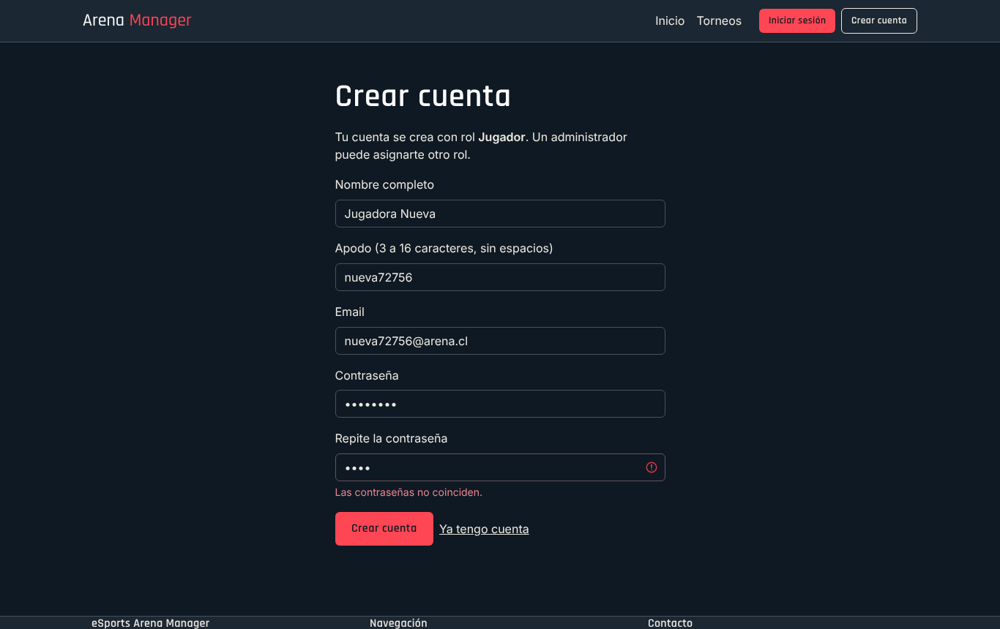

**Iniciar sesión** pide email y contraseña. Si son incorrectos, se muestra *Email o contraseña incorrectos*.
Si intentaste entrar a una página protegida (por ejemplo *Mi perfil*), después del login vuelves a esa página.
El recuadro *Cuentas de prueba* rellena el formulario con un clic.

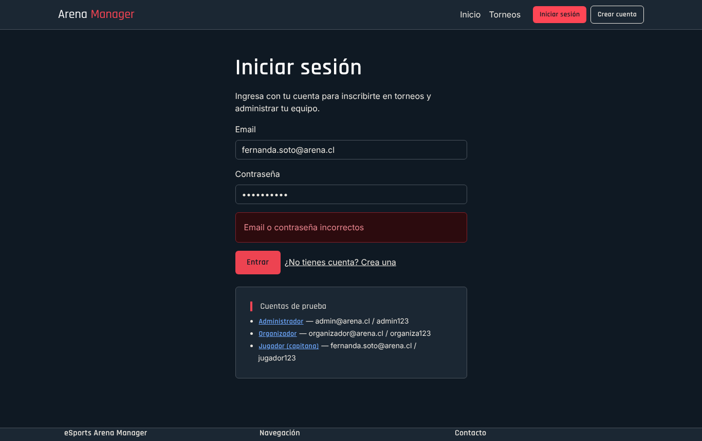

Con la sesión iniciada, el encabezado muestra tu nombre, tu rol y el botón **Cerrar sesión**. La sesión se mantiene
aunque recargues la página o cierres el navegador; dura hasta 7 días sin volver a escribir la contraseña.
Si la sesión deja de ser válida (por ejemplo, un administrador desactivó la cuenta) verás
*Tu sesión venció. Inicia sesión de nuevo.*

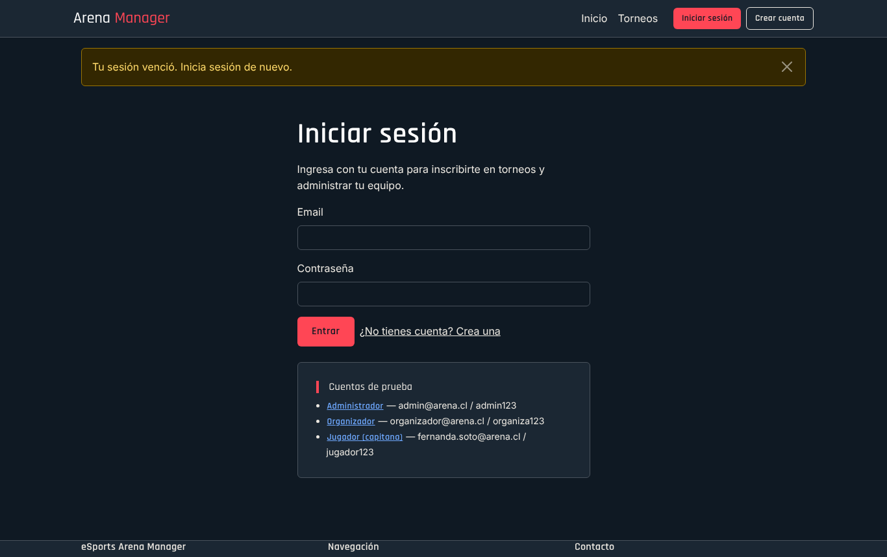

## 4. Mi perfil (jugador)

Muestra tus datos, estadísticas (victorias, derrotas y efectividad calculadas con los resultados), tus equipos,
tus sanciones (vigentes y cumplidas), tu historial de torneos y tus notificaciones. En **Editar apodo** puedes cambiar
tu apodo (único en la plataforma). Organizadores y administradores pueden elegir cualquier perfil en el selector.

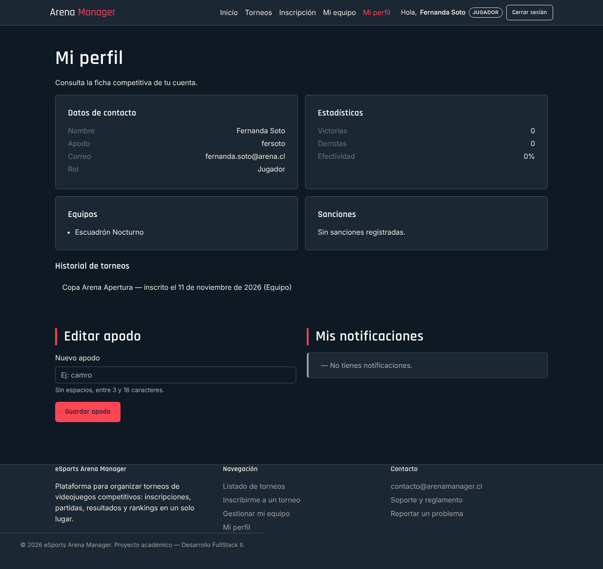

## 5. Inscribirse a un torneo

1. Abre **Inscripción** (o el botón *Inscribirme* del detalle del torneo).
2. Elige el torneo. La modalidad del juego define si se inscriben **jugadores** (individual) o **equipos**.
3. Un jugador se inscribe **a sí mismo**; para torneos por equipos, solo el **capitán** inscribe a su equipo.
4. El recuadro azul resume cupos disponibles, cierre de inscripción e integrantes exigidos.
5. Presiona **Confirmar inscripción**. Si algo no se cumple (plazo vencido, sin cupos, sanción vigente, equipo incompleto
   o ya inscrito) se explica el motivo.

A la derecha, **Mis inscripciones** lista tus inscripciones en torneos abiertos con el botón **Cancelar**.

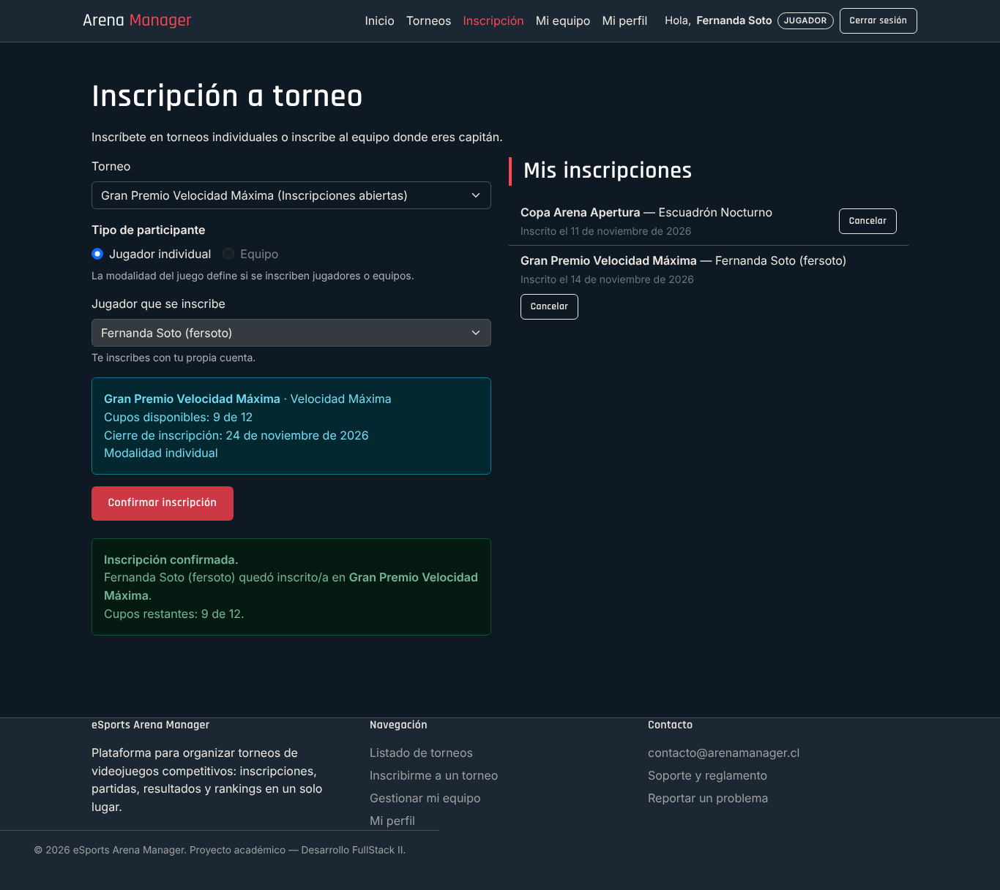

## 6. Mi equipo

- **Crear equipo:** nombre único, juego principal (por equipos) y capitán (un jugador siempre queda como capitán de su equipo).
- **Mis equipos:** elige uno de tus equipos para ver juego, capitán, estado e integrantes (con cuántos exige el juego).
- Solo el **capitán** (u organizador/administrador) puede **Agregar integrante** o **Quitar** a alguien. El capitán no se puede quitar.

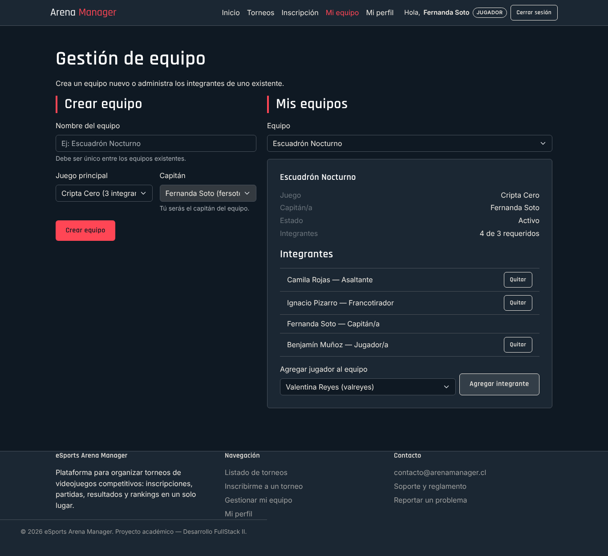

## 7. Panel de gestión (organizador y administrador)

Si un jugador intenta entrar a `/admin`, ve el aviso de permisos:

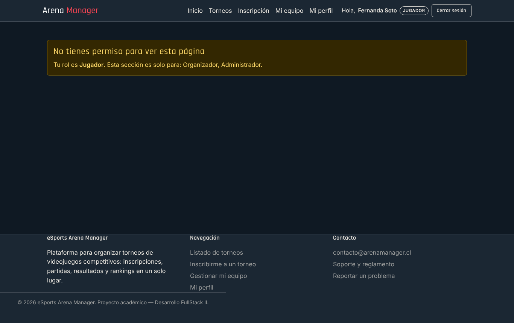

### 7.1 Torneos

- **Nuevo torneo:** nombre, juego, cierre de inscripción, inicio, término, cupo, estado inicial y descripción.
  El inicio debe ser posterior al cierre de inscripción.
- En la tabla se cambia el **estado** (Borrador, Abierto, Cerrado, En curso, Finalizado, Cancelado), se **edita** nombre,
  cupo y descripción, y el administrador puede **eliminar**. Un torneo en curso no admite cambios de reglas.

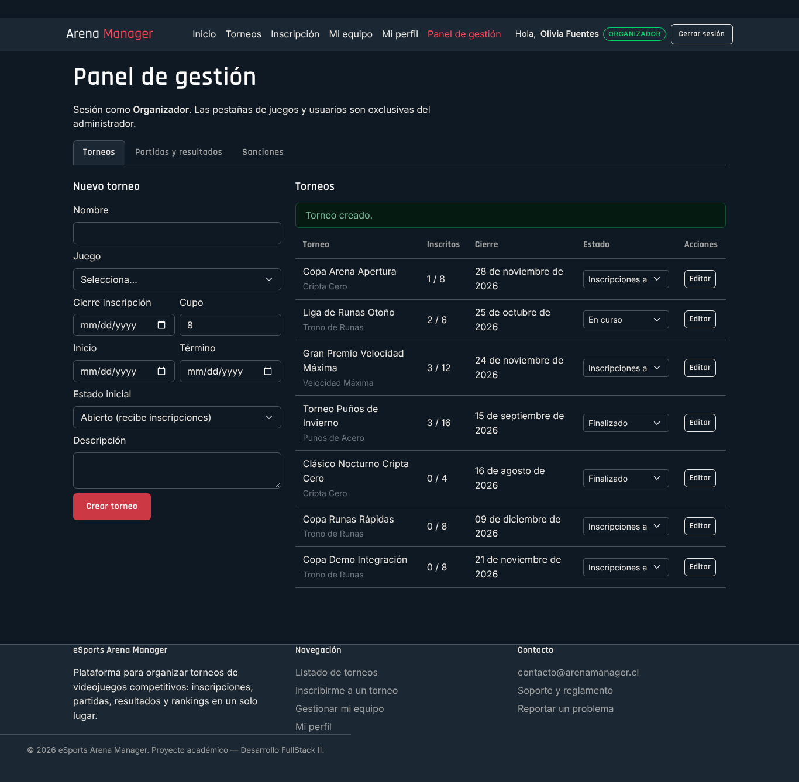

### 7.2 Partidas y resultados

Elige el torneo, selecciona dos participantes inscritos, la ronda y la fecha, y presiona **Programar**.
Para registrar el resultado, escribe los puntajes y presiona **Resultado**: el ganador se calcula solo y la partida
pasa a *jugada*; la tabla de posiciones del torneo se actualiza. **Cancelar** anula una partida programada.

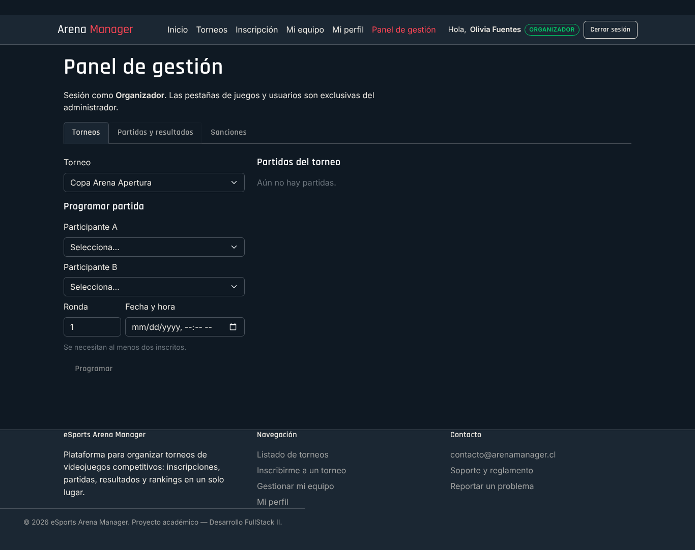

Al registrar un resultado, el detalle del torneo actualiza la llave y la tabla de posiciones:

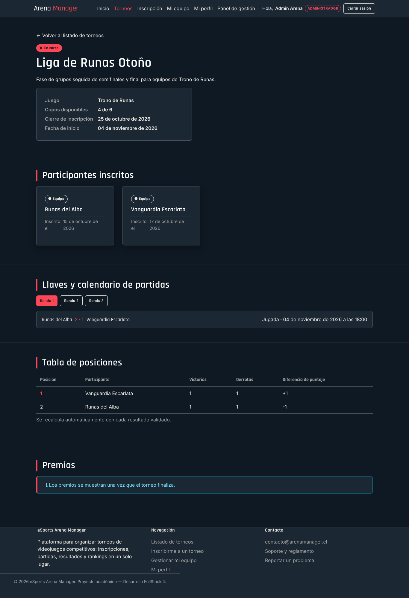

### 7.3 Sanciones

Registra una sanción (jugador, motivo, vigencia y severidad). Una sanción **bloqueante** vigente impide inscribirse.
**Cerrar** termina la sanción antes de tiempo.

### 7.4 Juegos (solo administrador)

Crea juegos (nombre, género, modalidad e integrantes por equipo), actívalos/desactívalos o elimínalos.
Un juego inactivo no permite crear torneos ni equipos nuevos.

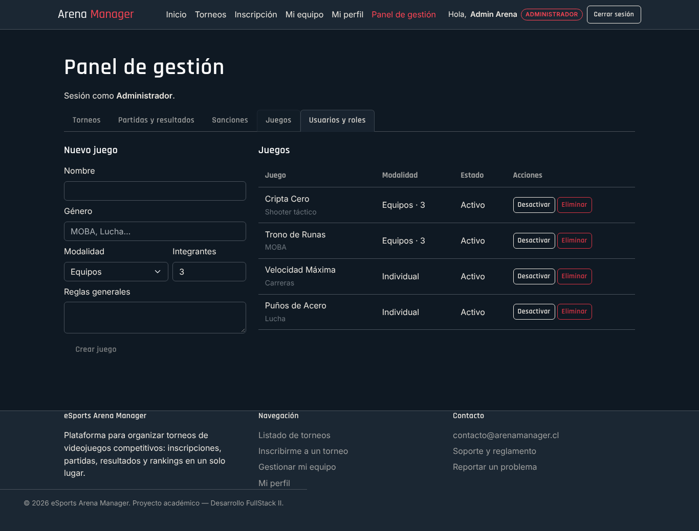

### 7.5 Usuarios y roles (solo administrador)

Lista las cuentas con su rol y estado. Cambiar el **rol** (Jugador, Organizador, Administrador) se aplica cuando la
persona renueva su sesión; **Desactivar** cierra todas sus sesiones. Tu propia cuenta no se puede modificar desde aquí.

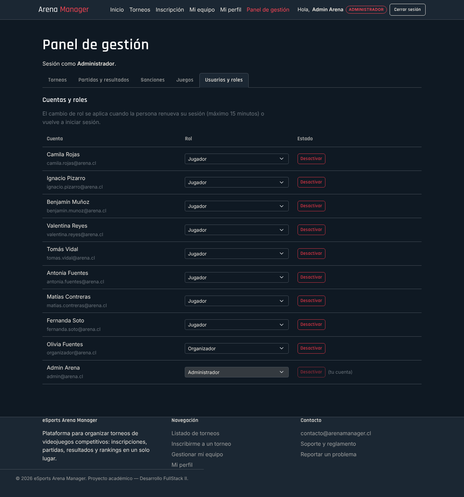

## 8. Mensajes frecuentes

| Mensaje | Qué significa |
| :-- | :-- |
| *Email o contraseña incorrectos* | Revisa los datos o crea una cuenta |
| *Tu sesión venció. Inicia sesión de nuevo.* | La sesión ya no es válida; vuelve a ingresar |
| *No tienes permiso para ver esta página* | Tu rol no puede usar esa sección |
| *Sin permiso para esta acción* | El servidor rechazó la acción por tu rol |
| *Solo el capitán puede inscribir al equipo* | Pide al capitán que haga la inscripción |
| *No inscribir fuera de plazo* / *No superar cupos* | El torneo cerró inscripciones o está lleno |
| *Algunos servicios no respondieron* | Un servicio está iniciando; presiona **Reintentar** en unos segundos |

## 9. Documentación técnica de la API

Para desarrolladores: Swagger unificado en `http://localhost:8070/swagger-ui.html` (o la URL del Gateway en Render).
Selecciona el servicio arriba a la derecha y usa **Authorize** con el token obtenido en `POST /api/v1/auth/login`.

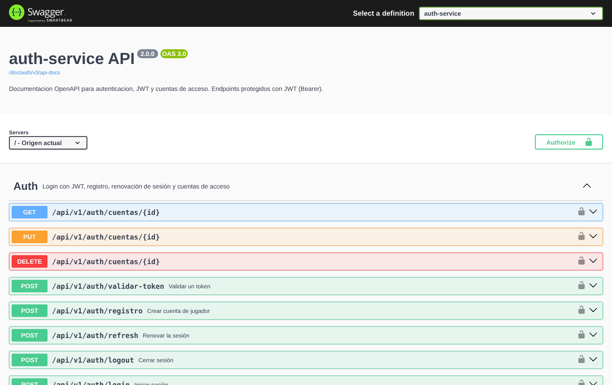
